# Хроники Гофера. Сезон 4: Зима близко. Битва за Энергию (Ресурсы, Планирование и Королевский SLA)

- **Язык сервисов:** Go 1.27
- **Стенд:** Локальный форт k3d (2 ноды)
- **Инструменты оптимизации:** krr (Kubernetes Resource Recommender), hey / k6
- **Гвардрейлы безопасности:** Кремень-Стена Kyverno (наследие третьего сезона)
- **Namespace приложения:** shop
- **Железо:** MacBook Air M1, 8 ГБ RAM, 256 ГБ SSD

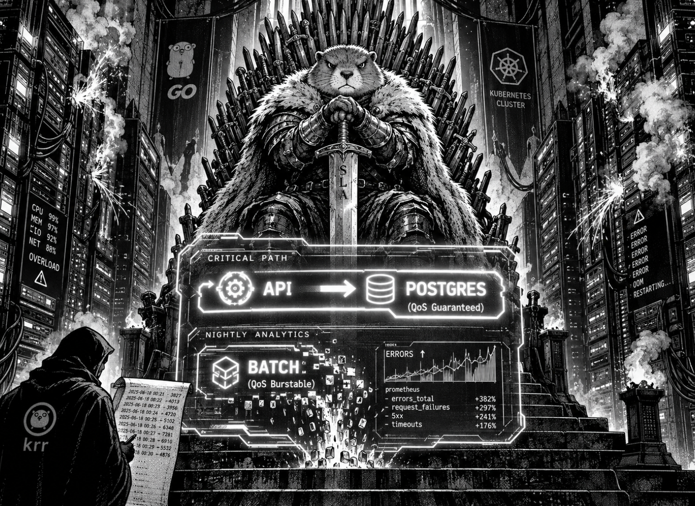

## Введение и цель работы. Сюжетная арка: Долгая зима

Продолжение хроник...

В прошлом сезоне мы поднимали завод `"ООО Gopher-shop"`: ставили на проходной Ростехнадзор `Kyverno`, писали генеральный план через `Helm`, приставляли к складу робота-завскладома `CloudNativePG` и даже пережили саботаж главного штаба. Завод работал как часы. Заказы текли рекой, сундуки ломились от золота, а директор Гофер спокойно пил кофе в своём кабинете, созерцая мирные графики в диспетчерской.

А потом наступила зима..

Не та, что приносит обычный снег. Другая. Леденящий цифровой шторм, после которого королевство `Kubernetes` меняется до неузнаваемости. Хранитель вышел утром на стену, и не узнал свои земли. Мирные цеха превратились в осаждённые замки. Лорды `Deployment` яростно делят между собой последние клочки свободных земель. Безродные бастарды `Pod` скитаются по замерзающим нодам. А над всем этим хаосом вершит свой суд Великий Механический Десница - планировщик `Scheduler`, решая, кому даровать тепло жизни, а кого обречь на вечный холод в состоянии `Pending`.

Генераторы подстанции барахлят. Энергии `CPU` и `RAM` катастрофически не хватает.

Перед Железным Троном встаёт вопрос, от которого зависит судьба всего королевства: кого кормить в первую очередь, а кого - вытеснить за Стену?

- **Северные лорды `api`** - суровые, верные, держат оборону критического пути оформления заказов. Их нельзя обделить питанием - если падут они, падёт всё королевство.
- **Хитрые лорды `worker`** - всегда платят свои долги: медленно, но верно разгребают завалы на складах. Но даже их верность имеет предел под гнётом холода.
- **Дикие за Стеной `batch`** - орда одичалых, Вольный народ. Прут из ледяной пустоты ночной аналитики, жрут прорву энергии и не производят ничего, кроме бесконечных свитков с отчётами. Их не приручить к порядку - они не признают ни королей, ни лимитов. Но их можно вытеснить обратно за Стену.

Замерзающий приграничный форт `k3d`, строго `1–2 ноды`. Чем теснее наши земли - тем быстрее и яростнее наступит Долгая Зима.

Ибо ночь темна и полна ужасов и `OOM`-киллеров.

Гасим свет и смотрим, кто же все-таки выживет...

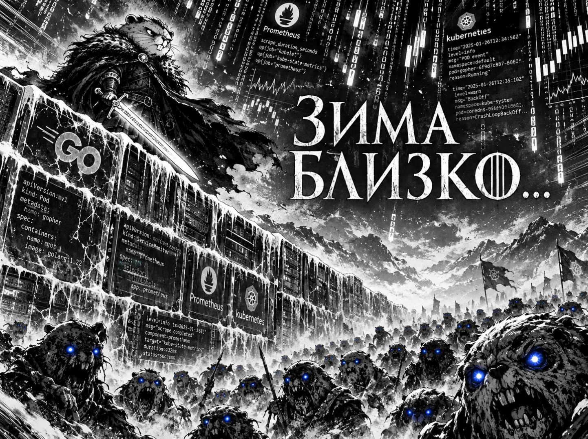

## Отступление летописца: как Хранитель менял крепость

Старый форт `OrbStack` для осады не годился: один замок, а его дозорные `cAdvisor` не отдают вестей о том, сколько цех жрёт энергии - ни одной метрики `container`. Без этих глаз Мастер над монетой `krr` слеп. Пришлось строить новую крепость `k3d` с двумя замками-нодами, где у каждого стража свой амперметр. Метрики зажглись - `16 лучей container_cpu_usage_seconds_total`.

Но новый форт встретил теснотой. Весь поход держим на MacBook Air M1, 8 ГБ RAM, 256 ГБ SSD. Ноды упёрлись в потолок 1.5 ГБ, `CPU взвыл на 700%`, воины посыпались в `CrashLoopBackOff` - CNPG не поднимал webhook, `Kyverno` блокировал даже удаление упавших, `etcd` захлёбывался от каскада перезапусков. Резали по живому: `Loki`, `Alloy` и `Jaeger` отправили на мороз - для драмы сезона не нужны. Оставили костяк - `Prometheus`, `Grafana`, `Alertmanager`, `Karma`, `Kyverno`. CPU `упал с 700% до 25%`, воины вернулись в строй. Зимовка продолжается.


## Часть 0 - Сервис batch. Сюжетная арка: Дикие за Стеной

Выпускаем из-за Стены орду одичалых `batch`, заглушка для ночной аналитики.

Пишем третий сервис `cmd/batch/main.go`: HTTP-сервер на порту `8082` с ручками `/health` и `/metrics`, в фоне крутит двух пожирателей. `cpuBurn` без остановки считает математику в цикле, `memBurn` аллоцирует чанки памяти и держит их, чтобы heap рос.

В `Dockerfile` добавлен третий этап - сборка бинарника `batch` в `scratch`-образ:

```bash
docker build --target batch -t shop-batch:1.0.0 .
```

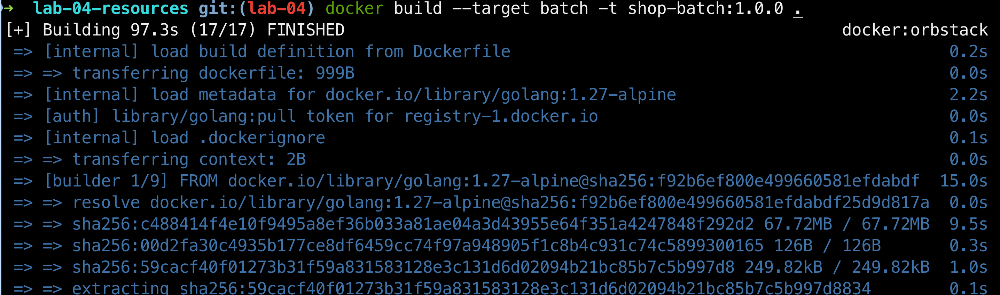

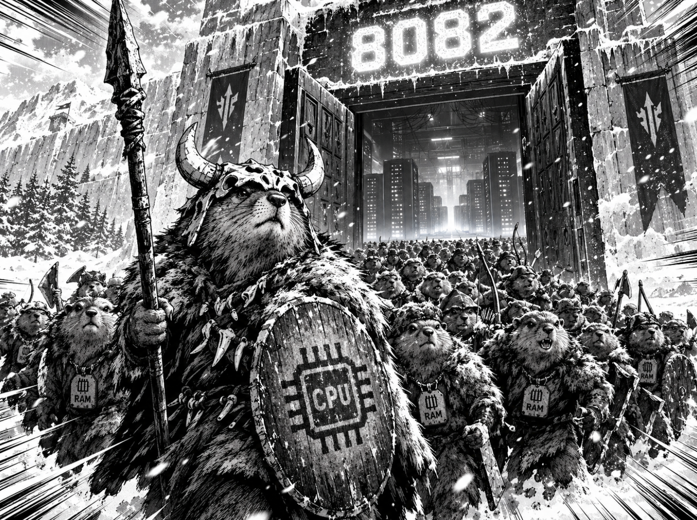

## Часть 1 - Выбери механизм разнесения. Сюжетная арка: Разделяй и властвуй

### Шаг 1.1. Испытание двух клинков

Лорды Севера кладут на стол два клинка:
Первый - `podAntiAffinity`, стальное правило: `не сажать реплики api рядом!`. Второй - `topologySpreadConstraints`, валирийский: `держать перекос между замками-нодами не больше одного пода`.

Выбор режима живёт в `values.yaml`:

```yaml
spread:
  mode: topologySpread
```

Рендерим оба режима через `helm template`:

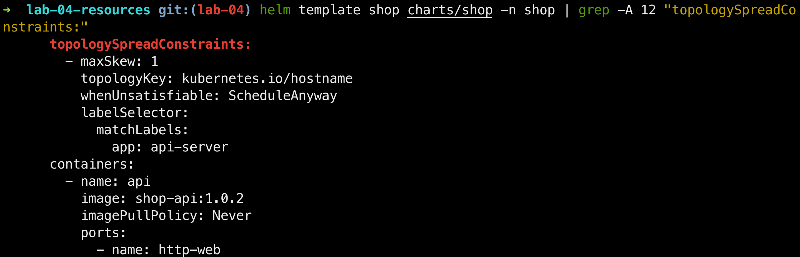

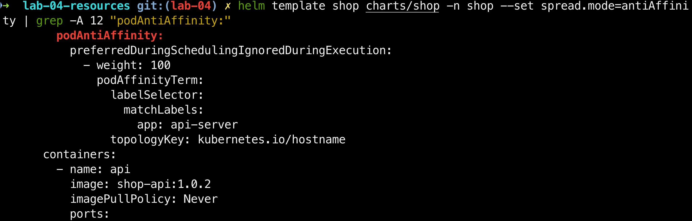

Выбран валирийский клинок `topologySpreadConstraints`. `podAntiAffinity` работает попарно - этот под не с этим подом, но не следит, чтобы поды распределились равномерно. `topologySpreadConstraints` смотрит на весь набор сразу и держит баланс. Для трёх реплик `api` по нодам важно именно равномерное распределение, поэтому выбран `spread`.

---

### Шаг 1.2. Кровь на клинке

Выбранный клинок испытан в бою! Применяем режим в живой кластер и проверяем, куда встали поды api - теперь в королевстве два замка, `k3d-shop-server-0` и `k3d-shop-agent-0`.

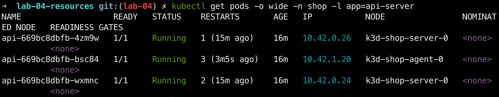

Реплики разъехались по обоим замкам, перекос не больше одного пода - как и велит `maxSkew: 1`. Один удар по замку не унесёт весь род...

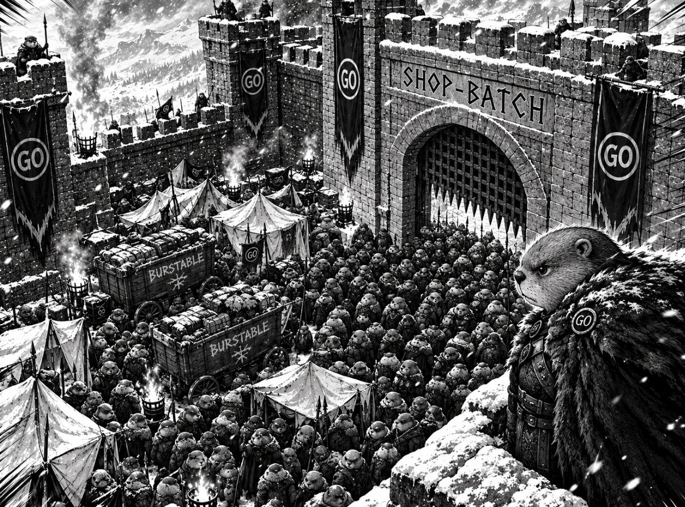

---

## Часть 2 - Тесная площадка. Сюжетная арка: Осада Королевской Гавани

Земли скудны - всего два замка-ноды, `k3d-shop-server-0` и `k3d-shop-agent-0`. Каждый такт CPU и мегабайт на счету. Выпускаем одичалых `batch` в чарт `shop` с честными `requests` и `limits` - `гвардрейлы Kyverno` не спят даже в осаде. Здесь начинается дефицит, что запустит всю драму сезона...

### Шаг 2.1. Дикие у ворот

Оказалось, в старых свитках `api`, `worker` и `postgres` уже высечены имена `shop-critical` и `shop-normal`, а самих лордов приоритета в королевстве нет. Поды держатся на честном слове - падут при первой же пересборке. Выковываем `priorityclass.yaml` и ставим трёх лордов на их законные места.

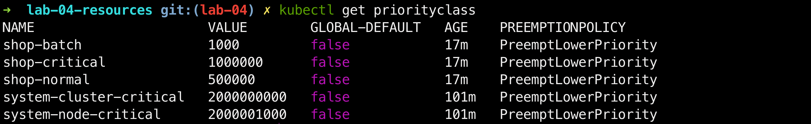

Теперь выпускаем одичалых. Пишем шаблон `batch-deployment.yaml` - с низким приоритетом `shop-batch`, тремя пожирателями энергии и пробами здоровья. `helm lint` и `helm template` подтверждают: дикие откованы, требования Kyverno соблюдены!

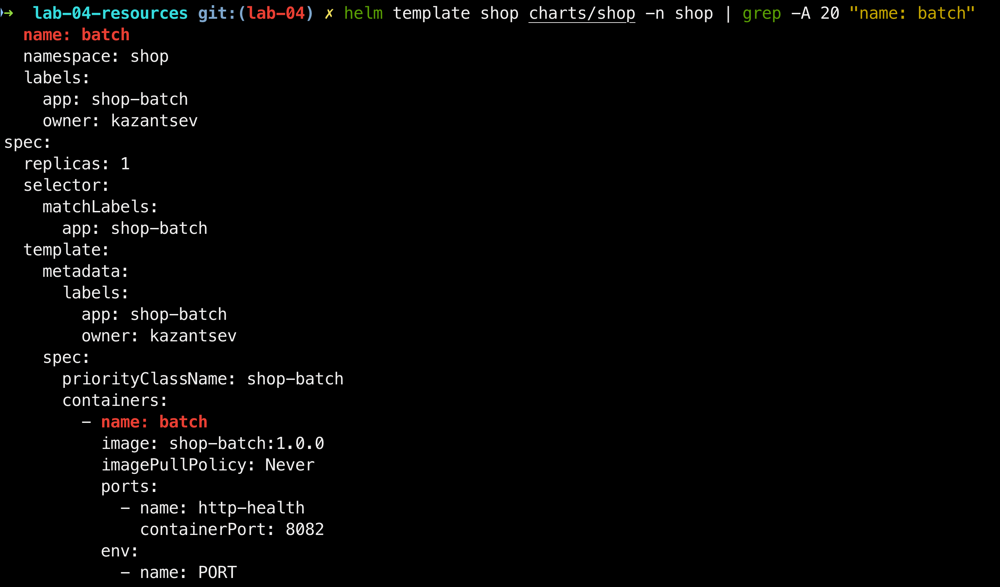

---

### Шаг 2.2. Осада начинается

Применяем релиз в кластер. Семь подов в строю: тройка `api`, пара `worker`, хранитель `postgres` и новые одичалые `batch`.

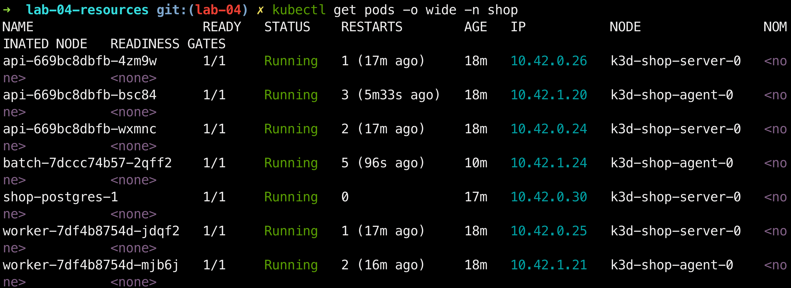

Проверяем кастовую принадлежность диких. `priorityClassName`: `shop-batch`, `QoS Burstable` - ресурсы есть, как велят гвардрейлы, но по классу они ниже лордов `api` и титана `postgres`. Первыми пойдут на вытеснение, когда зима прижмёт.

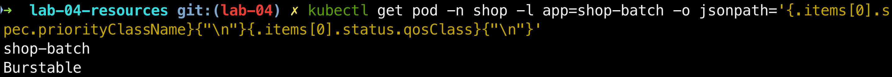


---

## Часть 3 - Реальные числа вместо угадывания. Сюжетная арка: Мастер над монетой

Королевская казна пуста, а лимиты написаны от балды. Гоним осадные машины по пути заказа, даём шпионам `Prometheus` собрать каждую каплю. Потом зовём `Мастера над монетой krr` - он взвесит каждое ядро и вынесет честный вердикт. Больше никаких догадок!

### Шаг 3.1. Осадные машины

Заряжаем катапульту `hey`. Бьём по `api` двумя потоками - `POST /order` и `GET /orders`. Шпионы `Prometheus` считают каждый удар.

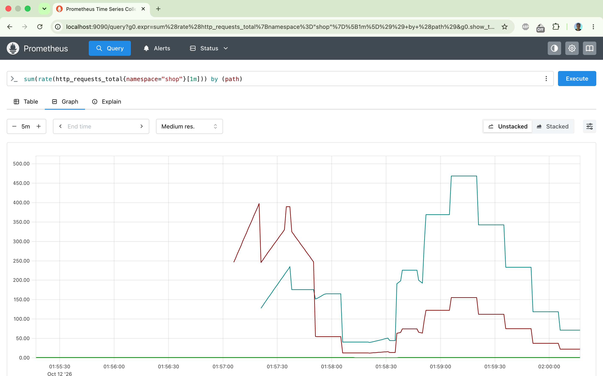

Всплеск виден, казна не пуста!

---

### Шаг 3.2. Учёт золота

Мастер над монетой `krr` прошёлся по казне `shop` и вынес вердикт по `api`. Догадка оказалась далека от правды:

CPU request `50m` -> `134m`, под нагрузкой api жрёт в `2.7` раза больше. Отсюда его падения под осадой.

CPU limit `200m` -> `снять`. Сжимаемый ресурс, лимит лишь душит - Мастер велел убрать.

Memory `128Mi/256Mi` -> `100Mi/100Mi`, сервису столько не нужно, а равенство `requests` и `limits` даёт `Guaranteed`.

По `worker` и `batch` вердикта нет: worker переснят недавно, истории меньше часа. batch в вечном OOM-цикле - истории не наберёт вовсе.

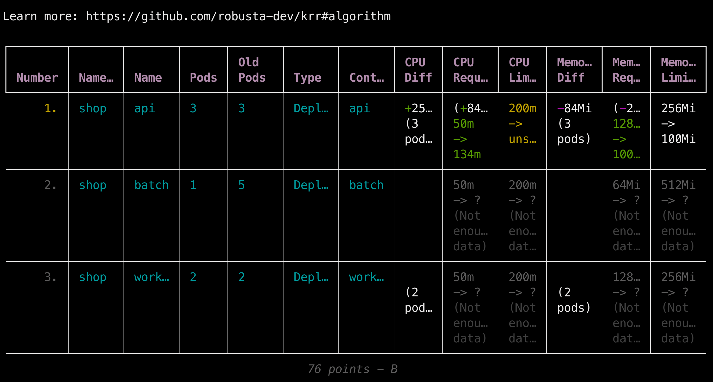

### Шаг 3.3. Новая казна

Ресурсные грамоты `api` переписаны на числа Мастера над монетой, релиз обновлён через `helm upgrade`. Но путь к новой казне оказался устлан трупами - три беды встали на дороге.

Первая - проклятие Харренхола `Jaeger`. Мы изгнали тяжёлый Jaeger из форта ради памяти, но `otel.endpoint` в `values.yaml` остался. Каждые несколько секунд `api` слал воронов с трейсами в пустую цитадель. Вороны бились о стены, вестовые застывали в глухом ожидании на `13-21` секунду, намертво блокируя дозорную ручку `/health`. Палач `kubelet` рубил поду голову. Кругом рестартов Хранитель терял реплики. Спасла строка `otel.endpoint: ""` - трейсер сам стал безмолвной заглушкой.

Вторая - палач сир Григор `Kyverno`. Безжалостный страж проходной, верный закону `require-resources`, требовал `CPU limit`, который Мастер велел убрать. Пришлось королевской волей переписать регламент на Стене: отныне `CPU requests` и `memory limits обязательны`, а `CPU limit - избыточное бремя`.

Третья - удушье в катакомбах `etcd`. Тайное хранилище тайн задыхалось на 8 ГБ мака от своры надсмотрщиков. Пришлось отсечь три щупальца стража `Kyverno` - контроллеры `background`, `cleanup` и `reports` отправили на мороз. Остался только верный рыцарь `admission`. Минус `140 Mi RAM и 290m CPU` - измученный etcd наконец вздохнул.

После всех правок лорды api переродились с новыми грамотами, а релиз взошёл на седьмую ревизию.

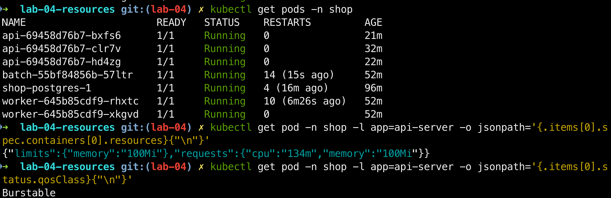

`QoS` пока `Burstable` - без CPU limit равенства request = limit не бывает, и Железный Трон не признал их высшей знатью. Зимовка продолжается...


---

## Часть 4 - Разнеси критический сервис. Сюжетная арка: Один род - две стены

### Шаг 4.1. Клятва дозорных

Северный род `api` не собрался в одном замке. Дозорные заняли обе стены королевства - `k3d-shop-server-0` и `k3d-shop-agent-0`.

```bash
kubectl get pods -o wide -n shop -l app=api-server
```

Двое встали на серверной стене, третий - на агентской. Перекос `2 vs 1` - ровно дозволенная мера. Дозорные держат слово.

Падёт одна стена - уйдёт в ядро, отрежется от мира, обратится в пепел - род api не погибнет разом. На второй стене останется живой дозорный, и оформление заказов не остановится. Не будь разнесения, все три реплики сидели бы в одном замке - и один удар унёс бы весь дом Старков разом.

Высокий `priorityClass`: `shop-critical` даёт им вторую броню: `api` и рассеян по королевству, и первый в очереди на пир ресурсов...

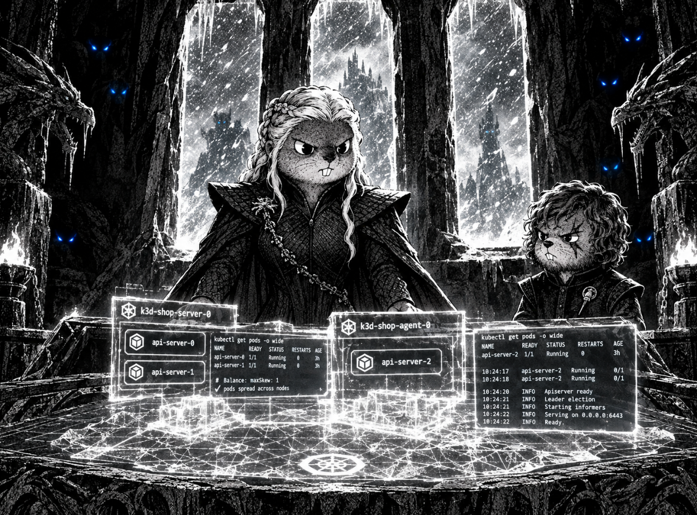

---

## Часть 5 - Приоритеты и гарантии. Сюжетная арка: Высшие и бастарды

Вводим кастовую систему. Высшая Знать api и postgres получают статус Guaranteed (requests равны limits), высокий priorityClass и PodDisruptionBudget - священный иммунитет. Бесправная Чернь batch получает Burstable и низкий приоритет: лимиты есть, как требуют гвардрейлы, но при первой угрозе её выкинут за ворота. Объясняем в README, чем Burstable отличается от Guaranteed по порядку вытеснения.

---

## Часть 6 - Создай нехватку, поймай preemption. Сюжетная арка: Кровавая свадьба

Устраиваем рукотворный голод. Поднимаем batch.replicas в values.yaml, забиваем requests, пока кластер не перестанет вмещать. И тут начинается резня: api и postgres как высокие лорды силой вышвыривают диких batch с их тёплых мест прямо на мороз в Pending. Ловим момент preemption и объясняем, почему планировщик считает по requests, а не по факту.

---

## Часть 7 - Давление по памяти, порядок жертв. Сюжетная арка: Раскулачивание

Поднимаем потребление batch через values.yaml, дожидаемся давления по памяти на ноде. Королевский палач kubelet выходит на плаху и пускает под нож Burstable-бедноту первой - критический путь Guaranteed выживает. Учимся отличать мгновенную казнь OOMKilled (под превысил свой лимит) от позорного изгнания eviction (нода под давлением). Два разных приговора с одним и тем же трупом.

---

## Часть 8 - Докажи SLA под нагрузкой. Сюжетная арка: Битва при Черноводной

Пока королевство полыхает в огне Pending и eviction, начинаем яростный обстрел критического пути катапультами k6 и hey. Формулируем свой SLA (например, «95% заказов быстрее 300 мс даже под перегрузкой»), снимаем графики задержек и ошибок. Замки горят, стены плавятся - но королевский SLA обязан устоять, а деградировать будет именно batch.

---

## Часть 9 - Мониторинг. Сюжетная арка: Птички Вариса

Расставляем по углам королевства незаметных шпионов - ServiceMonitor и PrometheusRule поверх промышленного комбайна из второго сезона. Три сигнальных костра - три алерта на перегрузку: CPU throttling, NodeMemoryPressure, PodEvicted. Они не умеют держать мечи, но первыми зажгутся в режиме firing, когда из-за Стены ломанутся Иные. Провоцируем срабатывание хотя бы одного и показываем в диспетчерской КИПиА.

---
