# Хроники Гофера. Сезон 5: Гарри Гоффер и Тайный Постгрес

- **Стенд:** Kubernetes-кластер k3d / kind (Школа Хогвартс)
- **Базовый CNI:** Cilium + Hubble (Карта Мародеров для трафика)
- **Движок ИБ:** NetworkPolicy с режимом default-deny (Щит Экспекто Патронум!)
- **Развертывание:** Helm-чарт shop из 3 сезона (Косой переулок)
- **Целевая СУБД:** PostgreSQL (Тайная комната)
- **Железо:** MacBook Air M1, 8 ГБ RAM

---

## Введение

В прошлом сезоне мы распределяли ресурсы, ставили PDB и приоритеты - но так и не ответили на главный вопрос: `как всё продолжает работать, когда поды непрерывно умирают и пересоздаются с новыми IP?`

В этом сезоне Гарри Гоффер поступает в Школу Хогвартс. Едва переступив порог, он замечает две беды. Первая - коридоры школы запутаны: номера аудиторий меняются каждый день, и совы с письмами летают кругами, не зная, куда нести ответ. Вторая - в подвалах прячется Тайная комната, и её хранитель `PostgreSQL` пускает к себе кого угодно - хоть первокурсника, хоть чужого гостя из другого факультета.

Старшие студенты лишь пожимают плечами: `"Так всегда было, привыкай"`. Но Гарри не привык.

А вскоре он замечает третью беду, о которой вслух не говорят. Кто-то невидимый уже успел подложить в защиту Тайной комнаты своё заклятие - тонкое, как змеиный шёпот. Студенты клянутся, что не трогали политики. Значит, дело рук того, чье имя нельзя называть...

План Гарри:

- Нарисовать Карту Мародеров (`Cilium` + `Hubble`), чтобы видеть весь трафик - каждую сову, каждый шорох в коридорах.
- Доказать, что чары `Service` держат школу на плаву, даже когда поды под капотом умирают и перерождаются в новых телах.
- Поставить на входе в Тайную комнату Щит Экспекто Патронум (`NetworkPolicy` default-deny), что пропускает только тех, кому положено.
- Найти поломку в защите, которую кто-то подложил. И найти её не гаданием - а по Карте.

Школа большая, но Гарри уже знает: главные тайны Хогвартса - не в учебниках, а в коридорах. И самая опасная из них сейчас тихо ждёт, затаившись в одной из сетевых политик.

---

## Часть 0 - Выбери CNI. Сюжетная арка: Распределяющая шляпа

Распределяющая шляпа опускается на голову Гарри... Перед ним два главных факультета - два CNI, способных применять сетевую магию. В отличие от маглского дефолтного `kindnet` (как Дурсли, которые ничего не смыслят в волшебстве и молча игнорируют политики), эти двое действительно умеют колдовать.

`Слизерин (Calico)` - классический выбор, надежно применяет защитные заклинания, но скрывает от глаз происходящее в коридорах. `Гриффиндор (Cilium)` - смельчак на eBPF, дающий не только защиту, но и полную видимость трафика.

"Хмм, - шепчет Шляпа вкрадчиво. - Трудно. Очень трудно. Много смелости, вижу. И ум неплохой. И желание проявить себя... Слизерин помог бы тебе на пути к величию, это точно..."

Только не Слизерин, только не Слизерин! - отчаянно шепчет Гарри, крепко зажмурив глаза, не желая оставаться слепым в подземельях Calico.

"Не Слизерин? Ты уверен? Что ж, если ты так добр... Пусть будет ГРИФФИНДОР!" - кричит Шляпа на весь зал.

Почему `Гриффиндор (Cilium)`, а не `Слизерин (Calico)`? `Calico` честно держит сетевые щиты, но не дает Карты Мародеров. А без нее Гарри в Части 6 будет вслепую гадать, где именно заблокирован трафик. Инструмент `Hubble` у Cilium наглядно визуализирует весь поток: какая сова куда полетела и на каком барьере ее сбили. Тут наглядность важнее классики.

Ставим `Cilium` с `Hubble`. Сетевая магия плагина активирована!

---

## Часть 1 - Разверни shop и исследуй сеть пода. Сюжетная арка: Первый день в Хогвартсе

### Шаг 1.1. Знакомство в Большом зале

Гарри входит в Большой зал. Школа (кластер) уже полна жизни: чарт `shop` развернут, и каждый житель (под) получил свою комнату.

Смотрим на распределение: `api` и `worker` заняли места на разных башнях (нодах - `server` и `agent`), а у каждого пода есть свой уникальный магический адрес (IP), выданный Cilium.

---

### Шаг 1.2. Тайные коридоры замка

А теперь давай заглянем в самые потаенные коридоры школы.

Гарри заходит в гостиную к поду `api` на башне `server`. Смотрит на его волшебный интерфейс `eth0`. У него адрес `10.0.0.97`, а маска `/32` - это как заклинание, которое говорит, что в этой комнате больше никого нет, только он. Cilium наложил на него чары точного адреса, чтобы совы не путали двери.

А если выглянуть из комнаты в коридор самой башни `server`, там висит целая паутина из восьми невидимых нитей. Это концы волшебных проводов `veth`, которые тянутся от каждого жителя к его башне. Cilium сплел эту сеть так, чтобы все были на связи.

Ну а теперь главная проверка. Гарри берет сову и отправляет ее с башни `server` (`10.0.0.97`) прямо на башню `agent` (`10.0.1.211`). Сова летит без всяких обманов и подмен (NAT). И возвращается с ответом: `0% packet loss`.

Значит, коридоры Хогвартса работают как надо!

---

## Часть 2 - Докажи непрерывность через хаос подов. Сюжетная арка: Непростительные заклятия

### Шаг 2.1. Империус

Тёмные силы накладывают заклятие Империус на наши поды. Сначала мы выносим `api` наружу через `NodePort`. Это наш Парадный вход для клиентов.

Разбираемся с типами сервисов:

- `NodePort` открывает один и тот же порт `30080` на каждой ноде-башне. Клиент стучится на адрес любой башни, и его пропускают внутрь. Просто и не зависит от облака.
- `LoadBalancer` требует внешнего балансировщика от облачного провайдера (настоящий магический щит). В нашей школе `k3d` его нет, поэтому этот тип повис бы в статусе `pending`.
- `headless` без ClusterIP вообще не дает виртуального адреса. Он просто отдает список IP всех живых подов. Слишком сложно для клиента, которому нужен один стабильный вход.

Нам нужен именно `NodePort`.

Затем мы запускаем скрипт `chaos-pods.sh` в фоне. Заклятие Империус заставляет случайного жителя `api` или `worker` умирать каждые 15 секунд. Но чары школы сильнее - Kubernetes тут же пересоздает их в новом теле с новым IP.

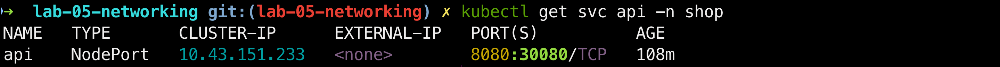
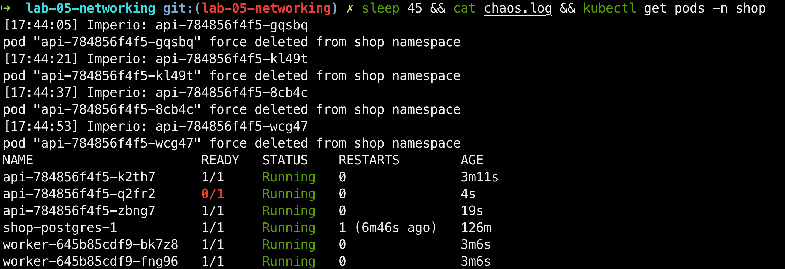

---

### Шаг 2.2. Сопротивление воли

Пока Империус убивал поды, Гарри запустил поток заказов через `load.sh`. Клиенты стучатся по имени (`api.shop`), не зная настоящих адресов.

Графики доказали, что нагрузка стабильно идет `до 40 rps`, а `ошибки 5xx` пусты. Ни один заказ не потерялся!

Почему? Четыре слоя магии держат удар: `Service` - стабильная дверь, `EndpointSlice` - список живых, `kube-proxy` - правила в ядре и `DNS` - совиная почта.

Наш `kube-proxy` работает в режиме `iptables`. На маленькой школе разницы с `IPVS` нет, но на тысячах сервисов iptables начнет тормозить.

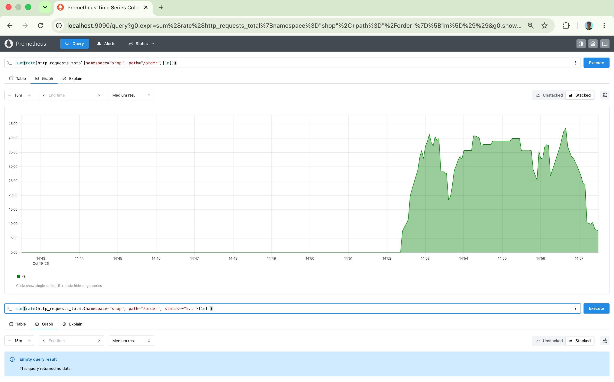
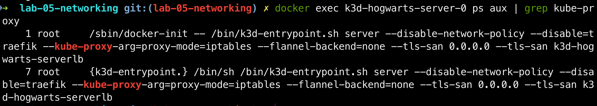

---

## Часть 3 - Спроектируй целевую матрицу доступа. Сюжетная арка: Карта Мародеров

### Шаг 3.1. Торжественно клянусь, что замышляю шалость!

Гарри, Фред и Джордж, разворачивают Карту Мародеров. Близнецы Уизли только что передали этот волшебный пергамент Гарри, и теперь им втроем нужно четко понять, кто, где и куда имеет право ходить в коридорах сети, прежде чем ставить Щит Экспекто Патронум.

"Смотри, Гарри, - шепчет Фред, указывая светящейся палочкой на линии пергамента. - Карта показывает каждую сову, каждый под и каждую потайную лазейку".

Вместе они набрасывают строгую целевую матрицу доступов:

- Клиент снаружи стучится в api через Парадный вход `NodePort`, минуя облачные преграды.
- Легитимные обитатели `api` и `worker` имеют право ходить в Тайную комнату к хранителю postgres на `порт 5432`.
- Совиной почте `DNS:53 в kube-system` летать разрешено отдельно, иначе имена в школе перестанут резолвиться и совы заблудятся.
- Смотрителю Филчу `cnpg-system` открываем проход на порт 8000, без этого он не сможет проверить пульс базы, и она тут же уйдет в аварию.
- Посторонним подам-шпионам вход в Тайную комнату строго запрещен!

План утвержден, Карта Мародеров зафиксировала легитимные маршруты, Шалость удалась!

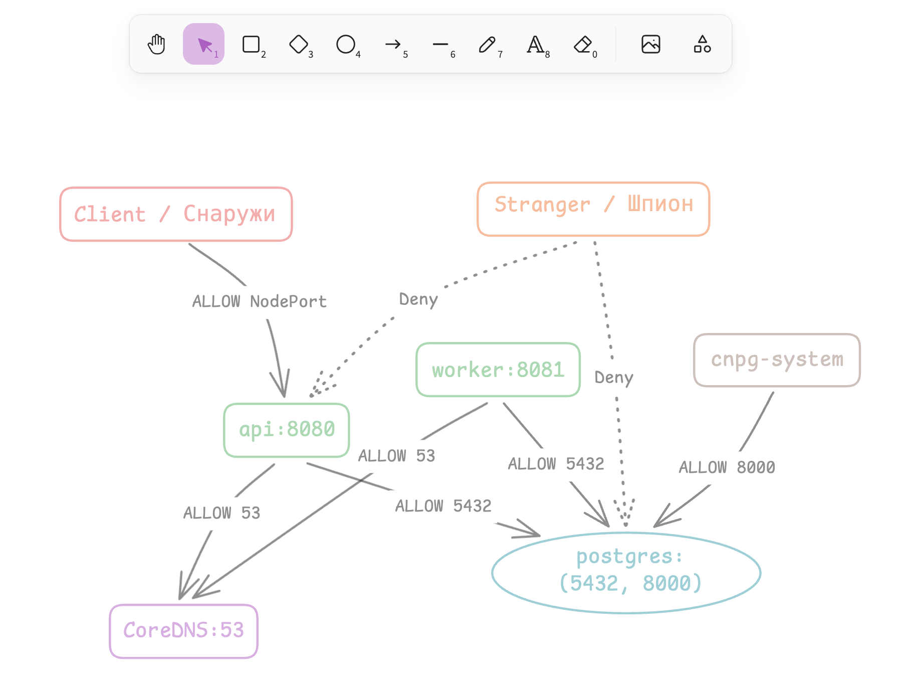

---

## Часть 4 - Включи zero-trust. Сюжетная арка: Возведение защитного купола над Хогвартсом

### Шаг 4.1. Протего Тоталум!

Битва за Хогвартс начинается! Защитники школы направляют палочки в ночное небо и произносят "Протего Тоталум!". Над замком смыкается мощнейший купол `default-deny`, блокируя весь входящий и исходящий трафик.

Все лейблы и порты мы прячем в `values.yaml`, а в шаблон чарта добавляем шесть магических барьеров. Поверх глухого купола точечно открываются проходы по меткам: клиенту в `api`, `api` и `worker` в Тайную комнату `postgres`, плюс разрешаем сов `DNS` и проверки от смотрителя Филча (`cnpg-system`).

Применяем Helm-релиз. Kubernetes возвел 6 NetworkPolicy:

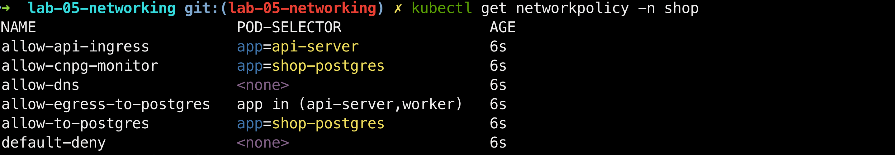

Главное доказательство работы магии - `Cilium` взял эти политики на вооружение. В `cilium-dbg endpoint list` у подов `api-server` и `worker` колонки POLICY INGRESS и POLICY EGRESS переключились в статус `Enabled`. Школа официально перешла в режим Zero-Trust!

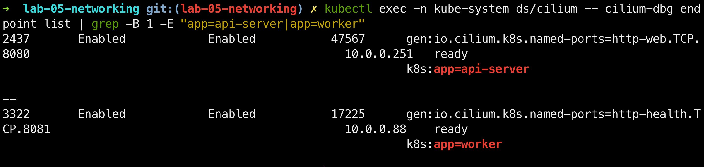

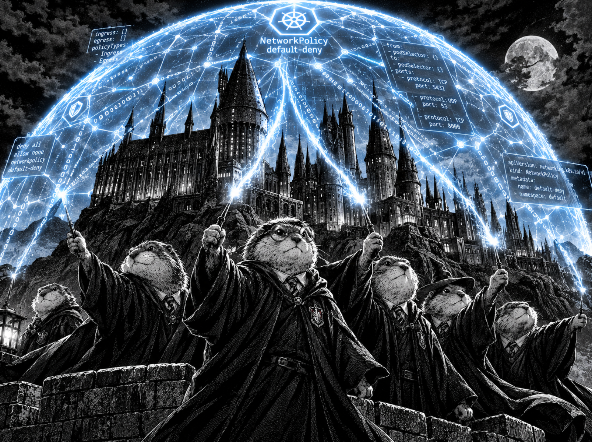

---

## Часть 5 - Докажи матрицу на практике. Сюжетная арка: Отряд Дамблдора

### Шаг 5.1. Выручай-комната

Защитный купол возведен, но, как часто напоминал профессор Дамблдор: "Школа - это место, где всегда окажут помощь тем, кто её просит. Но только если их метки `Labels` верифицированы".

Чтобы убедиться, что защитные чары Хогвартса работают без осечек, Отряд тайно собирается в Выручай-комнате и запускает заклинание тотальной проверки - скрипт `test-matrix.sh`. Он отправляет тестовых сов из разных концов замка на штурм Тайной комнаты.

Результаты магической переклички сошлись идеально:

- Свои `api` и `worker` спокойно проходят к базе - ALLOW.
- Посторонний шпион `stranger` бьется о стену и получает отказ - DENY.

Купол Экспекто Патронум доказал свою силу!

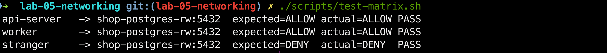

---

## Часть 6 - Найди скрытую поломку связности. Сюжетная арка: Крестражи Тёмного Лорда

### Шаг 6.1. Дневник Тома Реддла

Тёмный Лорд подложил крестраж. Скрипт `break.sh` вслепую выбирает одно из четырёх тёмных заклятий и применяет его через `values.yaml`. Симптом мгновенный: магия заказов ломается, матрица краснеет, `api` и `worker` теряют связь с `postgres`.

---

### Шаг 6.2. Меч Гриффиндора

Армия Тёмного Лорда у ворот...

Вместо слепого гадания мы смотрим в самую суть через магию Hubble. В логах виден точечный сброс: `shop/worker -> shop/shop-postgres-1:5432 EGRESS DENIED`. Причина найдена: крестраж изменил порт, и Тайная комната оказалась запечатана.

Словно в решающий миг битвы, Невилл выхватывает Меч Гриффиндора из Распределяющей шляпы. Одним сокрушительным ударом он отрубает голову Василиску - сломанной политике, закупорившей вход в `postgres`. Точная команда через Helm возвращает порт `5432`.

Матрица снова зеленая, а шпион заперт. Крестраж уничтожен не случайным тыком, а благодаря точному взгляду в сетевые потоки!

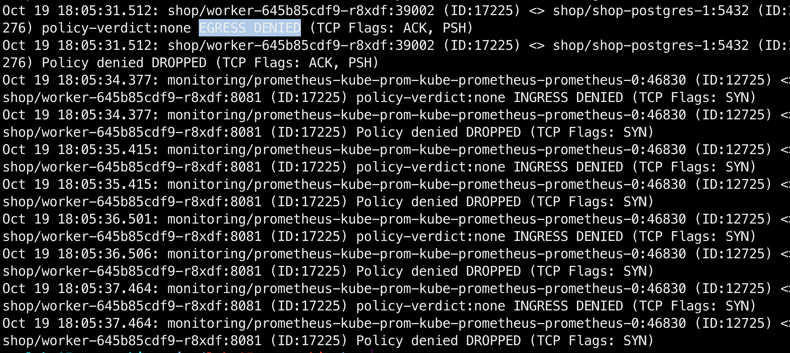

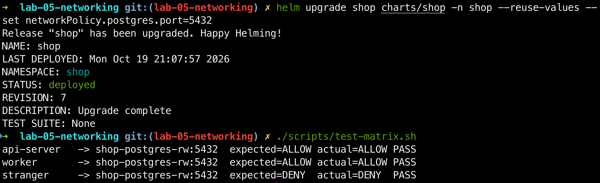

---

## Часть 7 - Мониторинг. Сюжетная арка: Газета "Ежедневный пророк"

### Шаг 7.1. Экстренный выпуск!

Мы ставим на стражу Хогвартса Снитчей `ServiceMonitor` и три сигнальных заклинания `PrometheusRule`:

1. `HighPolicyDeniedRate` (Купол бьет) - всплеск пакетов, заблокированных NetworkPolicy.
2. `DNSErrors` (Совы заблудились) - сбои резолва CoreDNS.
3. `APIConnectionDrops` (Косой переулок закрыт) - падение трафика к api.

Запускаем шпиона-спамера, и Снитчи тут же ловят аномалию. Алерт `HighPolicyDeniedRate` пылает красным в статусе `FIRING`. Министерство магии в курсе.

Графана не выдержала нагрузки на наш скромный мак и ушла в тень. Но Снитчи не дремлют - сам Prometheus видит все цели живыми `UP` и бьет тревогу как надо.

Тёмный Лорд повержен, заказы проходят, мониторинг верен Хогвартсу...

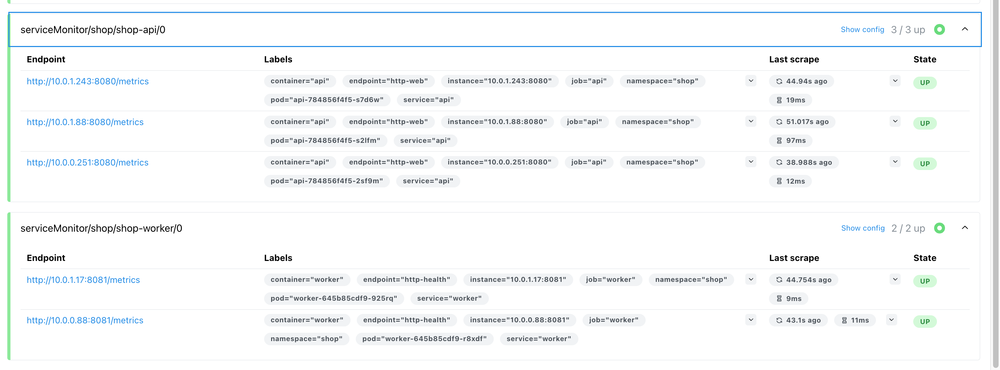
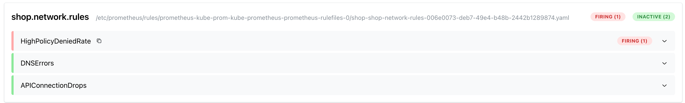
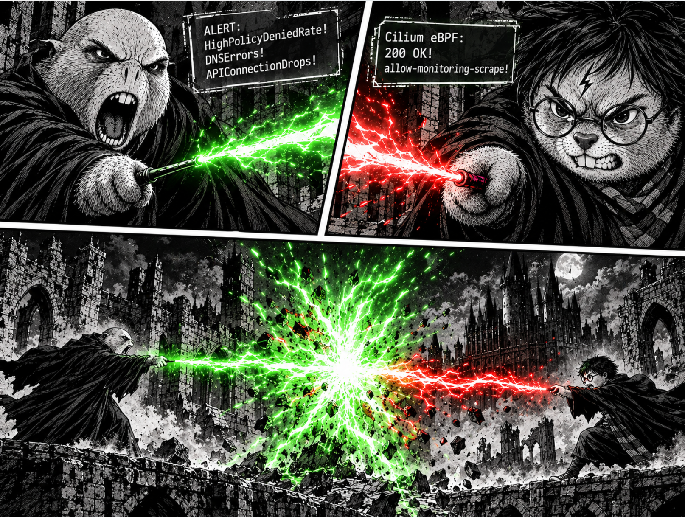

---

### Шаг 7.2. Тьма отступила

- **Рон:** Почему она не сработала? Авада Кедав..
- **Гарри:** Волан-де-Морт считал, что эта политика принадлежит ему. Но настоящая сила была в руках того, кто создал её - того, кто первым сказал "разрешить всё!".
- **Гермиона:** Значит, эта политика принадлежит тебе?
- **Гарри:** Принадлежала. Несколько дней назад я сломал её, когда включил `default-deny`.
- **Рон (с благоговением):** Значит, ты - хозяин политики "разрешить всё"?
- **Гарри:** ...я.
- **Рон:** И что мы с ней сделаем?
- **Гермиона (обеспокоенно):** Точнее, что ты с ней сделаешь Гарри?

После этого вопроса Гарри без слов берёт старый манифест с политикой "разрешить всё" обеими руками, с треском рвёт его пополам и бросает обломки в пропасть под мостом. Рон и Гермиона смотрят на него в шоке, но затем Гарри берёт их за руки, и они молча смотрят вдаль - туда, где горит зелёным `200 OK`...

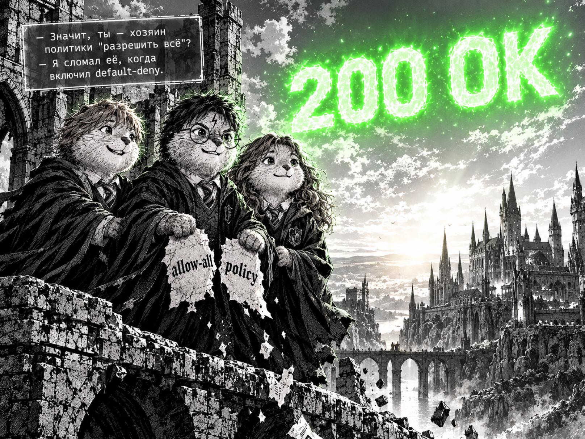

---
