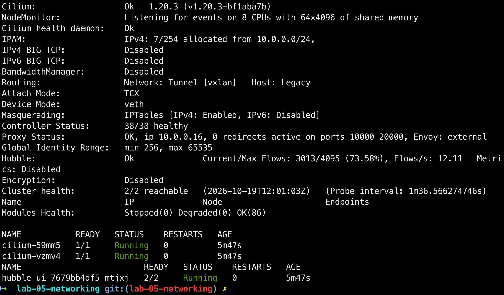
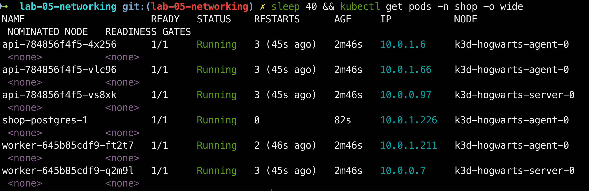
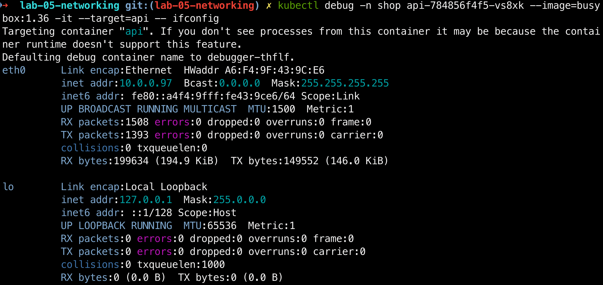
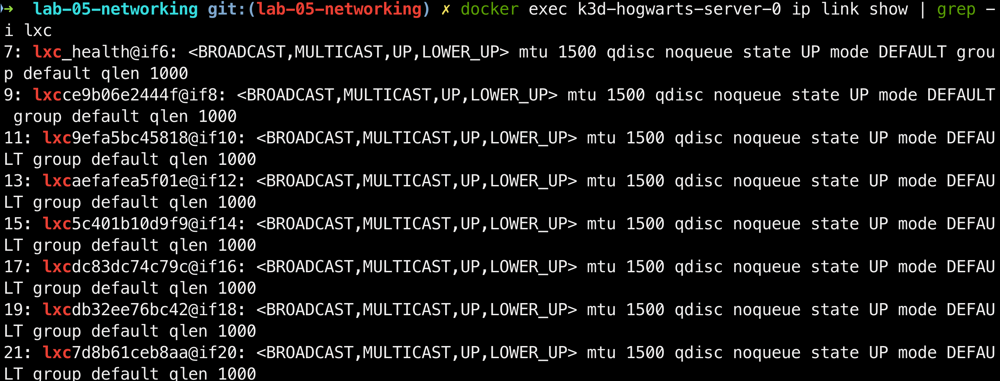
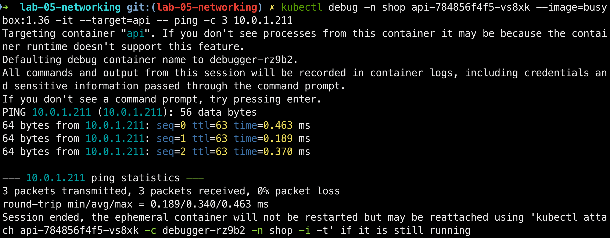

# Хроники Гофера. Сезон 5: Гарри Гоффер и Тайный Постгрес

- **Стенд:** Kubernetes-кластер k3d / kind (Школа Хогвартс)
- **Базовый CNI:** Cilium + Hubble (Карта Мародеров для трафика)
- **Движок ИБ:** NetworkPolicy с режимом default-deny (Щит Экспекто Патронум!)
- **Развертывание:** Helm-чарт shop из 3 сезона (Косой переулок)
- **Целевая СУБД:** PostgreSQL (Тайная комната)
- **Железо:** MacBook Air M1, 8 ГБ RAM

---

## Введение

В прошлом сезоне мы распределяли ресурсы, ставили PDB и приоритеты - но так и не ответили на главный вопрос: `как всё продолжает работать, когда поды непрерывно умирают и пересоздаются с новыми IP?`

В этом сезоне Гарри Гоффер поступает в Школу Хогвартс. Едва переступив порог, он замечает две беды. Первая - коридоры школы запутаны: номера аудиторий меняются каждый день, и совы с письмами летают кругами, не зная, куда нести ответ. Вторая - в подвалах прячется Тайная комната, и её хранитель `PostgreSQL` пускает к себе кого угодно - хоть первокурсника, хоть чужого гостя из другого факультета.

Старшие студенты лишь пожимают плечами: `"Так всегда было, привыкай"`. Но Гарри не привык.

А вскоре он замечает третью беду, о которой вслух не говорят. Кто-то невидимый уже успел подложить в защиту Тайной комнаты своё заклятие - тонкое, как змеиный шёпот. Студенты клянутся, что не трогали политики. Значит, дело рук того, чье имя нельзя называть...

План Гарри:

- Нарисовать Карту Мародеров (`Cilium` + `Hubble`), чтобы видеть весь трафик - каждую сову, каждый шорох в коридорах.
- Доказать, что чары `Service` держат школу на плаву, даже когда поды под капотом умирают и перерождаются в новых телах.
- Поставить на входе в Тайную комнату Щит Экспекто Патронум (`NetworkPolicy` default-deny), что пропускает только тех, кому положено.
- Найти поломку в защите, которую кто-то подложил. И найти её не гаданием - а по Карте.

Школа большая, но Гарри уже знает: главные тайны Хогвартса - не в учебниках, а в коридорах. И самая опасная из них сейчас тихо ждёт, затаившись в одной из сетевых политик.

---

## Часть 0 - Выбери CNI. Сюжетная арка: Распределяющая шляпа

Распределяющая шляпа опускается на голову Гарри... Перед ним два главных факультета - два CNI, способных применять сетевую магию. В отличие от маглского дефолтного `kindnet` (как Дурсли, которые ничего не смыслят в волшебстве и молча игнорируют политики), эти двое действительно умеют колдовать.

`Слизерин (Calico)` - классический выбор, надежно применяет защитные заклинания, но скрывает от глаз происходящее в коридорах. `Гриффиндор (Cilium)` - смельчак на eBPF, дающий не только защиту, но и полную видимость трафика.

"Хмм, - шепчет Шляпа вкрадчиво. - Трудно. Очень трудно. Много смелости, вижу. И ум неплохой. И желание проявить себя... Слизерин помог бы тебе на пути к величию, это точно..."

- Только не Слизерин, только не Слизерин! - отчаянно шепчет Гарри, крепко зажмурив глаза, не желая оставаться слепым в подземельях Calico.

"Не Слизерин? Ты уверен? Что ж, если ты так добр... Пусть будет ГРИФФИНДОР!" - кричит Шляпа на весь зал.

Почему `Гриффиндор (Cilium)`, а не `Слизерин (Calico)`? `Calico` честно держит сетевые щиты, но не дает Карты Мародеров. А без нее Гарри в Части 6 будет вслепую гадать, где именно заблокирован трафик. Инструмент `Hubble` у Cilium наглядно визуализирует весь поток: какая сова куда полетела и на каком барьере ее сбили. Тут наглядность важнее классики.

Ставим `Cilium` с `Hubble`. Сетевая магия плагина активирована!

---

## Часть 1 - Разверни shop и исследуй сеть пода. Сюжетная арка: Первый день в Хогвартсе

### Шаг 1.1. Знакомство в Большом зале

Гарри входит в Большой зал. Школа (кластер) уже полна жизни: чарт `shop` развернут, и каждый житель (под) получил свою комнату.

Смотрим на распределение: `api` и `worker` заняли места на разных башнях (нодах - `server` и `agent`), а у каждого пода есть свой уникальный магический адрес (IP), выданный Cilium.

### Шаг 1.2. Тайные коридоры замка

А теперь давай заглянем в самые потаенные коридоры школы.

Гарри заходит в гостиную к поду `api` на башне `server`. Смотрит на его волшебный интерфейс `eth0`. У него адрес `10.0.0.97`, а маска `/32` - это как заклинание, которое говорит, что в этой комнате больше никого нет, только он. Cilium наложил на него чары точного адреса, чтобы совы не путали двери.

А если выглянуть из комнаты в коридор самой башни `server`, там висит целая паутина из восьми невидимых нитей. Это концы волшебных проводов `veth`, которые тянутся от каждого жителя к его башне. Cilium сплел эту сеть так, чтобы все были на связи.

Ну а теперь главная проверка. Гарри берет сову и отправляет ее с башни `server` (`10.0.0.97`) прямо на башню `agent` (`10.0.1.211`). Сова летит без всяких обманов и подмен (NAT). И возвращается с ответом: `0% packet loss`.

Значит, коридоры Хогвартса работают как надо!

---

## Часть 2 - Докажи непрерывность через хаос подов. Сюжетная арка: Непростительные заклятия

### Шаг 2.1. Империус

Выносим api наружу через NodePort и запускаем скрипт хаоса chaos-pods.sh - поды теряют волю и непрерывно умирают под действием проклятия. В README приводим разбор Парадного входа: NodePort открывает порт на каждой ноде (башне замка), LoadBalancer требует внешнего балансировщика от облачной инфраструктуры, а headless дает прямой доступ к подам без выделения ClusterIP. Нам нужен именно NodePort - простая точка входа клиента, не зависящая от облака.

### Шаг 2.2. Сопротивление воли

Гоним нагрузку через load.sh по DNS. Доказываем графиком Grafana (0 провалов), что сеть сбрасывает чужой контроль и защищает свои связи благодаря kube-proxy, Service и EndpointSlice. Выясняем, что наш kube-proxy работает в режиме iptables. На маленьком хогвартском кластере разницы с IPVS нет - обе модели дают одинаковую скорость. Разница заметна только на масштабах в тысячи сервисов: iptables перебирает цепочки правил линейно, а IPVS ищет адреса мгновенно по хеш-таблице.

---

## Часть 3 - Спроектируй целевую матрицу доступа. Сюжетная арка: Карта Мародеров

### Шаг 3.1. Торжественно клянусь, что замышляю шалость!

Проектируем на бумаге (в README) целевую матрицу доступов для Хогвартса: детально расписываем, кому разрешено перемещаться по замку (клиент - api, api - PostgreSQL, worker - PostgreSQL), а для кого проход строго закрыт (посторонний под - PostgreSQL). Отдельно наносим на карту легитимные маршруты для прорицания имен (DNS) и выходов за пределы школы (egress).

---

## Часть 4 - Включи zero-trust. Сюжетная арка: Возведение защитного купола над Хогвартсом

### Шаг 4.1. Протего Тоталум!

Реализуем спроектированную матрицу как шаблоны NetworkPolicy в чарте shop, вынося лейблы и разрешенные порты в values.yaml. Подобно защитникам Хогвартса, направляющим палочки в небо, активируем режим default-deny для полной изоляции трафика к подам в namespace. Поверх купола точечно открываем нужные маршруты по меткам подов с указанием портов, отдельно разрешая DNS и необходимый egress.

---

## Часть 5 - Докажи матрицу на практике. Сюжетная арка: Отряд Дамблдора

### Шаг 5.1. Выручай-комната

Тестируем прочность защиты вживую: запускаем скрипт test-matrix.sh и из каждого пода пытаемся достучаться до каждого адресата. Сводим результаты проверок в итоговую таблицу "ожидаемо / фактически". Демонстрируем, что посторонний под-шпион полностью заблокирован и не может подключиться к PostgreSQL, в то время как легитимные api и worker беспрепятственно достигают базы, делая матрицу полностью зелёной

---

## Часть 6 - Найди скрытую поломку связности. Сюжетная арка: Крестражи Тёмного Лорда

### Шаг 6.1. Дневник Тома Реддла

Готовим 3–4 варианта темных заклятий (широкое deny-правило, неверные лейблы в allow, закрытый DNS/egress или несовпадение портов). Запускаем скрипт саботажа break.sh - он случайно выбирает и активирует один из "крестражей" через values.yaml. Фиксируем главный симптом: магия заказов полностью ломается и они перестают проходить.

### Шаг 6.2. Меч Гриффиндора

Открываем карту трафика Hubble и, словно выслеживая скрытый крестраж, находим точечное DROPPED-соединение. Вместо слепого гадания вычисляем причину блокировки, уничтожаем поломку точным исправлением (наш Меч Гриффиндора) и проверяем по матрице, что все поды снова горят зелёным. Путь диагностики и поиска артефакта детально описываем в README.

---

## Часть 7 - Мониторинг. Сюжетная арка: Газета "Ежедневный пророк"

### Шаг 7.1. Экстренный выпуск!

Добавляем в чарт шаблоны servicemonitor-cilium.yaml и prometheusrule-network.yaml, настраивая три критических триггера на метрики соединений, блокировок и DNS. Запускаем скрипт поломки break.sh, искусственно вызывая сетевую аномалию (HighPolicyDeniedRate). Газета мгновенно взрывается сенсацией на передовице - ловим боевой алерт в статусе firing.

### Шаг 7.2. Экспекто Патронум!

В ответ на атаку Тёмных сил выводим все "живые" метрики на итоговый дашборд Grafana. Словно серебряная лань, прорезающая ночную тьму, наш мониторинг наглядно доказывает полную победу над хаосом.
Сводим воедино все результаты: график 0 провалов, купол NetworkPolicy и чистую зелёную матрицу. Тёмный Лорд повержен, лаба сдана!

---
